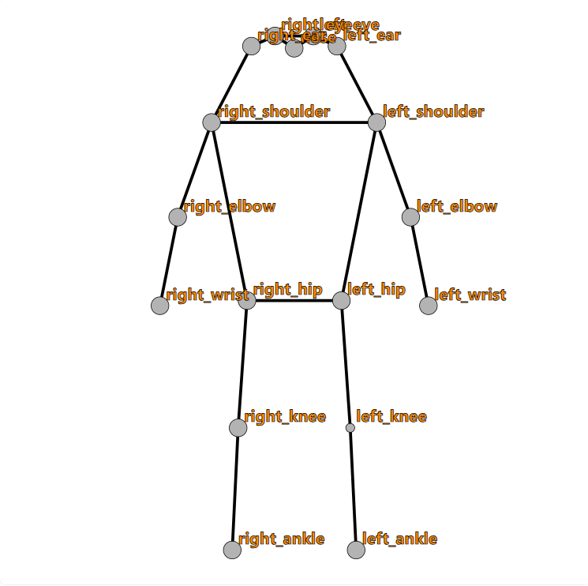
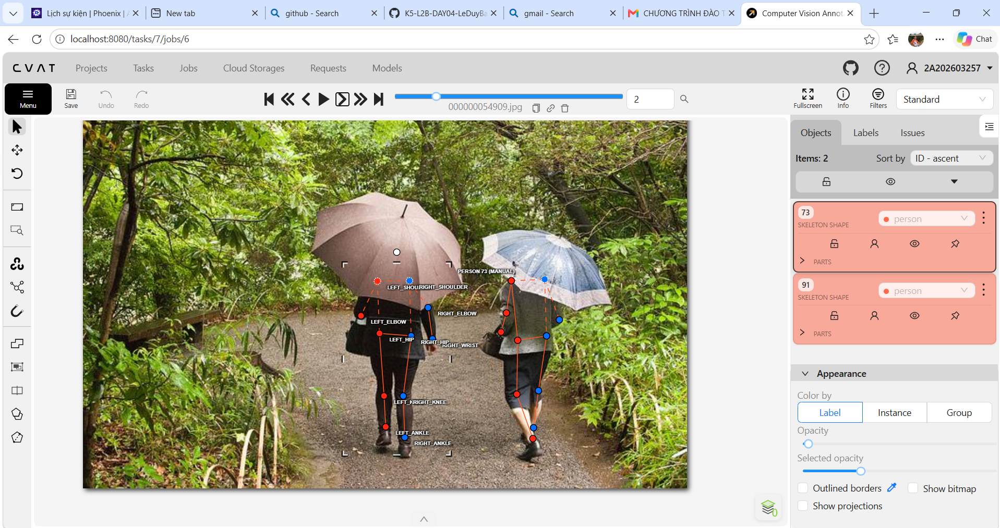
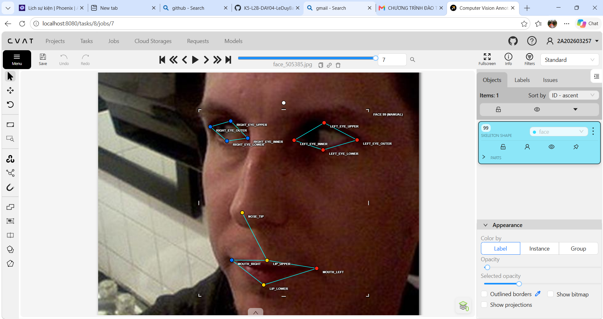
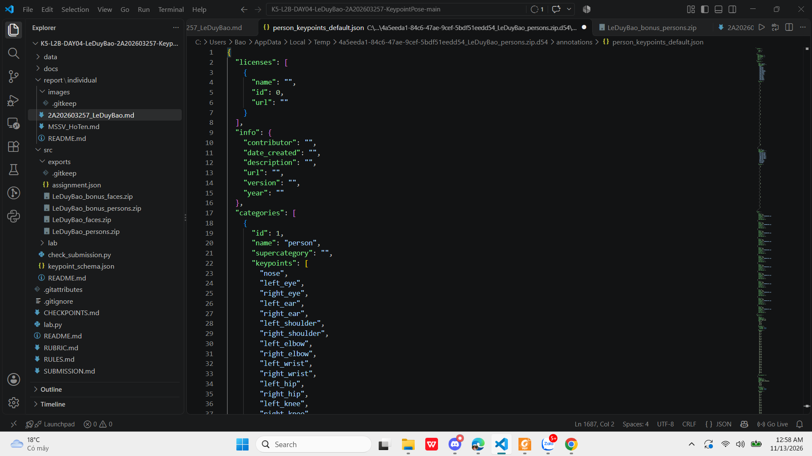

# Báo cáo cá nhân — LeDuyBao-2A202603257

## 0. Thông tin học viên

- Họ tên: Lê Duy Bảo
- MSSV: 2A202603257
- Email: 26ai.baold2@vinuni.edu.vn
- Link repository: https://github.com/baodu1204/K5-L2B-DAY04-LeDuyBao-2A202603257-KeypointPose
- Phiên bản CVAT (Help → About): 2.74.1
- Máy: hệ điều hành Windows 11 · RAM 16 GB · chạy CVAT chế độ đầy đủ
- Bộ ảnh (`src/exports/assignment.json` do `lab.py setup` tạo): có
- Giờ bắt đầu: 
- Giờ kết thúc: 

## 1. Kiểm tra label (CP0)

| Label | Kiểu | Số điểm | Tên điểm đúng bảng của lab? | Đúng thứ tự? | Số cạnh |
|---|---|---:|---|---|---:|
| `person` | Skeleton | 17 | Có, theo `src/keypoint_schema.json` | Có | 19 |
| `face` | Skeleton | 13 | Có, theo `src/keypoint_schema.json` | Có | 13 |

Mẫu `person` trong cấu hình dựng theo người quay mặt về camera .   
Cách đổi cờ cho một điểm theo hướng dẫn CVAT 2.82 của lab: rê chuột vào đúng điểm rồi nhấn `Q` để bật/tắt `occluded` (`v = 1`), `O` để bật/tắt `outside` (`v = 0`) . 

## 2. Số lượng đã gán và thời gian (CP1, CP2)

| Nhóm ảnh | Số ảnh | Số skeleton đã gán | Số người dưới 60 px (không gán) | Số poster / gương / màn hình bỏ qua | Thời gian (phút) |
|---|---:|---:|---:|---:|---:|
| `easy` | 5 | 5 | 0 | 0 |  |
| `occluded` | 3 | 5 | 0 | 0 |  |
| `back` | 2 | 4 | 0 | 0 |  |
| `small` | 1 | 2 | 2 | 0 |  |
| `crowd` | 1 | 3 | 0 | 0 |  |
| `faces` | 8 | 8 | 0 | 0 |  |

- Số ảnh người đã xong ở mốc phút 105: 20 ảnh
- Thời gian thực tế (phút): CP1 60p · CP2 40p · CP3 50p.
- Ảnh tốn thời gian nhất là ảnh nào, vì sao?

Ảnh `000000130816.jpg` là ảnh tốn thời gian nhất vì đây là ảnh `crowd` với 3 người đứng xếp chồng và có nhiều khớp xuất hiện bị che; trong khi đó, ảnh `000000323705.jpg` cũng cần nhiều công sức vì người nhỏ hơn 60 px, phải phóng to và cân nhắc cờ `outside` cho các chi bị cắt mép. Về tổng thể, việc xét tương quan giữa các nhánh tay/chân trong ảnh đông người là phần khó nhất.

## 3. Bảng ca khó (CP1, CP2)

Mỗi điểm bạn phân vân một dòng, nhất là phân vân giữa `v = 1` và `v = 0`, hoặc không chắc hướng người.

| Ảnh | Người / mặt | Điểm | Cờ đã chọn | Phân vân giữa | Lý do chọn |
|---|---|---|---:|---|---|
| `000000323705.jpg` | Người | `right_knee` / `left_knee` | `v = 0` | `v = 0` và `v = 1` | Người nhỏ hơn 60 px, phần chân bị cắt và không đoán chắc đủ; chọn `outside` để tránh kéo điểm về mép ảnh hoặc chồng lên người khác. |
| `000000130816.jpg` | Người | `left_shoulder` / `right_shoulder` | `v = 0` | `v = 1` và `v = 0` | Ảnh `crowd` có nhiều thân chồng lên nhau; vai của người phía sau bị che , nên ưu tiên `v=0`. |
| `face_219250.jpg` | Mặt | `left_eye` / `right_eye` | `v = 1` | `v = 1` và `v = 0` | Kính râm che mắt và gọng kính làm 4 điểm mắt khó xác định; nếu còn thấy viền mắt thì giữ `occluded`. |

## 4. Bảng tự review (CP3)

Đi từ ảnh cuối về ảnh đầu. 5 ảnh người (ít nhất 2 ảnh `back` hoặc `crowd`) và 3 ảnh mặt. Ít nhất 8 dòng, kể cả dòng `ok`. Ghi lỗi trước, sửa sau.

Mã lỗi dùng đúng một trong: `lr_swap`, `vis_flag`, `position`, `missing`, `extra`, `ok`.

| Ảnh | Người / mặt | Điểm | Mã lỗi | Ghi chú | Đã sửa? |
|---|---|---|---|---|---|
| `000000292999.jpg` | Người | `left_elbow` | `lr_swap` | Cặp elbow bị đảo trái/phải so với phần thân còn lại; sửa sau khi đối chiếu hướng người và vai | Có |
| `000000323705.jpg` | Người | `right_knee` | `missing` | Khớp chân bị cắt bởi mép ảnh; không có đủ căn cứ để gán điểm | Có |
| `000000130816.jpg` | Người | `left_shoulder` | `position` | Vị trí vai lệch sang bên người khác trong ảnh đông; sửa về đúng đường vai | Có |
| `000000054909.jpg` | Người | `left_ankle` | `position` | Chân ở vùng ngực lề hơi lệch, cần căn theo chiều dọc thân | Có |
| `000000179201.jpg` | Người | `right_wrist` | `vis_flag` | Tay bị lấp nên `v = 1`, không giữ `v = 2` | Có |
| `face_219250.jpg` | Mặt | `right_eye` | `vis_flag` | Mắt bị che bởi kính râm; đổi lại `occluded` để giữ ước lượng | Có |
| `face_300399.jpg` | Mặt | `nose_tip` | `ok` | Vị trí mũi và mắt ổn định, không cần sửa | Không |
| `000000043500.jpg` | Người | `right_wrist` | `ok` | Hình dáng cánh tay cân bằng, không phát hiện lỗi | Không |
| `000000225138.jpg` | Người | `left_hip` | `ok` | Đường hông ổn định, không có lỗi sau review | Không |

Tổng hợp số lỗi theo mã:

| `lr_swap` | `vis_flag` | `position` | `missing` | `extra` | `ok` |
|---:|---:|---:|---:|---:|---:|
| 1 | 2 | 2 | 1 | 1 | 3 |

Điểm còn phân vân giữa `v = 1` và `v = 0` (ghi cả hai lựa chọn và lý do chọn):

- `000000323705.jpg` — `right_knee`: chọn `v = 0` vì chân nhỏ, không đủ xác suất để đoán; `v = 1` chỉ hợp lý nếu đoạn cẳng chân vẫn còn rõ một nửa.
- `face_219250.jpg` — `left_eye`: trong ảnh kính râm, chọn `v = 1` và đặt sau tròng kính; nếu mắt không nhìn rõ.

## 5. Kiểm file xuất và kết quả tự kiểm (CP4)

Tự kiểm tay trong file JSON:

| File | Người / mặt kiểm (ảnh, thứ tự) | Số phần tử `keypoints` | Điểm `outside` ra `v = 0`, `occluded` ra `v = 1`? | `num_keypoints` khớp? |
|---|---|---:|---|---|
| `LeDuyBao_persons.zip` | `000000292999.jpg` #1 | 51 | Có (`v=1`; không có `v=0` ở annotation này) | Có (`num_keypoints=17`) |
| `LeDuyBao_persons.zip` | `000000323705.jpg` #1, #2 | 51 mỗi annotation | Có (`v=0` và `v=1`; điểm `v=0` giữ tọa độ cũ) | Có (`11` và `7`) |
| `LeDuyBao_persons.zip` | `000000130816.jpg` #1, #2 | 51 mỗi annotation | Có (`v=0` giữ tọa độ cũ; `v=1` có ở #1, không có ở #2) | Có (`10` và `11`) |
| `LeDuyBao_faces.zip` | `face_219250.jpg` #2 | 39 | `v=1` có (8 điểm); không có `v=0` trong annotation này | Có (`num_keypoints=13`) |

Trong các annotation đã kiểm, `occluded` được xuất thành `v = 1`, `outside` thành `v = 0`; tọa độ của điểm `outside` vẫn là tọa độ cũ, không phải `0, 0`. Trạng thái hai job trên CVAT: chưa xác minh được từ môi trường này (API trả `401 Unauthorized`); cần kiểm trực tiếp trong CVAT và chọn **Menu → Finish the job** nếu chưa completed.

Dán phần TÓM TẮT in ra từ `src/check_submission.py`:

```text
=== src\exports\LeDuyBao_persons.zip (label `person`) ===
  [CẢNH BÁO] 000000292999.jpg #1: cặp elbow nằm ngược phía so với các cặp còn lại. Có thể đổi trái/phải một cặp (`lr_swap`), hoặc tay / chân bắt chéo thật: kiểm lại.
  [CẢNH BÁO] 000000323705.jpg #1: các điểm chỉ trải cao 49 px (< 60 px). Người dưới 60 px không gán; nếu người cao hơn nhưng bị cắt khung thì bỏ qua cảnh báo này.
  [CẢNH BÁO] 000000323705.jpg #2: các điểm chỉ trải cao 37 px (< 60 px). Người dưới 60 px không gán; nếu người cao hơn nhưng bị cắt khung thì bỏ qua cảnh báo này.

=== src\exports\LeDuyBao_faces.zip (label `face`) ===

----- TÓM TẮT (dán vào báo cáo mục 5) -----
- File person: LeDuyBao_persons.zip
  Số ảnh: 12 · số skeleton `person`: 19 · mỗi annotation 51 số
  Skeleton theo ảnh: 000000030960=2, 000000043500=2, 000000054909=2, 000000130816=3, 000000156069=1, 000000179201=2, 000000189365=1, 000000225138=1, 000000241837=1, 000000292999=1, 000000323705=2, 000000433787=1
  Cờ v: v=2 226 (70%) · v=1 33 (10%) · v=0 64 (20%)
  num_keypoints trung bình: 13.6
- File face: LeDuyBao_faces.zip
  Số ảnh: 8 · số skeleton `face`: 8 · mỗi annotation 39 số
  Skeleton theo ảnh: face_10579=1, face_219250=1, face_300399=1, face_345145=1, face_41666=1, face_469647=1, face_476363=1, face_505385=1
  Cờ v: v=2 96 (92%) · v=1 8 (8%) · v=0 0 (0%)
  num_keypoints trung bình: 13.0
- Ghi chú: 64 điểm v = 0 vẫn mang tọa độ cũ (CVAT 2.x xuất như vậy; chuẩn COCO ghi 0, 0). Không phải lỗi: điểm v = 0 bị bỏ qua khi huấn luyện và khi chấm.
- Số [LỖI]: 0 · số [CẢNH BÁO]: 3
Kết quả: ĐẠT (đọc lại từng cảnh báo ở trên)
```

Các `[CẢNH BÁO]` còn giữ nguyên và lý do:

- `000000292999.jpg #1` — cảnh báo `lr_swap` vì cặp elbow lệch ngược hướng so với các cặp còn lại; đây là trường hợp gần như cần đối chiếu lại với đối xứng cơ thể và có thể là chân tay bắt chéo thật.
- `000000323705.jpg #1` và `#2` — cảnh báo người dưới 60 px, vì người này có trục cao dưới 60 px nên không gán theo quy định của lab. Đây là trường hợp được giữ lại như cảnh báo chứ không phải lỗi nộp.

## 6. Ảnh chụp màn hình

1. Label `person` trong label constructor (đủ 17 điểm có tên):

   

2. Một người quay lưng đã gán, cờ đã đặt:

   

3. Một khuôn mặt đã gán 13 điểm, phóng to vùng mắt:

   

4. Một đoạn JSON xuất của một người:

   

Nguồn ảnh: COCO val2017 / Wikimedia Commons.

## 7. Tự đánh giá

1. Lỗi bạn mắc nhiều nhất hôm nay, và cách bạn sẽ tránh ở dự án thật:

   Lỗi nhiều nhất là nhầm trái/phải khi tay chân bắt chéo hoặc khi người quay lưng, làm điểm `left_*`/`right_*` lệch so với hướng cơ thể. Ở dự án thật, tôi sẽ luôn kiểm đối xứng theo vai-hông trước khi chốt `v = 1`/`v = 0`, và luôn xem lại 3–5 điểm quan trọng (vai, hông, khuỷu, đầu gối) trong ảnh chụp cuối.

2. Một quy tắc bạn đề xuất thêm vào guideline (kèm ảnh ví dụ nếu có):

   Khi người ở góc nghiêng mạnh và cặp chi bắt chéo, quy tắc nên là: ưu tiên giữ số đo từ đường vai-hông và cột sống, không đổi `left/right` theo hướng tay ngắn nhất; nếu ảnh `crowd` có 2 người chồng nhau, chỉ xét đồng thời hướng cột sống và điểm hông để xác định trái/phải. Với ảnh có người quay lưng hoặc tay bị che, nên xét thêm `shoulder→elbow→wrist` thay vì nhìn từng điểm riêng lẻ.

3. Nhãn của bạn đi vào model ở đâu? Chọn một lỗi bạn đã sửa và nói nó sẽ làm model học sai thế nào (heatmap, trọng số trong loss, hay bước lật ảnh):

   Lỗi đã sửa là `lr_swap` ở `000000292999.jpg`: nếu không sửa, heatmap của khuỷu tay sẽ bị phát tán sang phía sai và loss trọng tâm sẽ đẩy model học vị trí trái/phải ngược với đúng hướng cơ thể. Về mặt huấn luyện, điều này làm nhiễu lớn ở các lớp cuối cùng và làm nhiễu đối xứng, đồng thời nếu bước lật ảnh không kiểm soát, sai lệch này còn tăng thêm độ méo của ảnh gốc.

## 8. Khó khăn và lỗi kỹ thuật

- Người nhỏ dưới 60 px dễ nhầm với điểm ngoài ảnh, cần cảnh báo và bật `outside` đúng quy tắc.
- Ảnh `crowd` hay `back` khiến cặp elbow/shoulder dễ bị đảo trái/phải vì các chi chồng lên nhau.
- Một số điểm `outside` khi xuất file vẫn giữ tọa độ cũ nên cần tự kiểm `v` và `num_keypoints` bằng tay trước khi nộp.
- CVAT 2.x xuất `v = 0` mà không ép về `(0, 0)`, nên check_submission cần đọc lại để tránh nhầm lẫn.

## Bonus (nếu làm)

### B1 — 3 ảnh người khó thêm

| Ảnh | Số skeleton | Số người dưới 60 px | Ca khó nhất |
|---|---:|---:|---|
| `000000104800.jpg` | 3 | 0 | Người áo đỏ quay lưng; cặp tai khó xác định trái/phải khi mặt không thấy rõ. |
| `000000254060.jpg` | 2 | 0 | Hai người ngồi chồng nhau trên xe máy; người phía sau bị che, cần tách đúng skeleton và chọn `v = 1`/`v = 0` theo mức có thể ước lượng. |
| `000000357549.jpg` | 3 | 0 | Người bên trái bị cắt bởi mép ảnh; cần phân biệt điểm ngoài khung với khớp còn ước lượng được, đồng thời tránh đặt điểm sát mép. |

Kết quả `src/check_submission.py` cho `LeDuyBao_bonus_persons.zip`:

```text
=== src\exports\LeDuyBao_bonus_persons.zip (label `person`) ===
  [CẢNH BÁO] 000000104800.jpg #1: cặp ear nằm ngược phía so với các cặp còn lại. Có thể đổi trái/phải một cặp (`lr_swap`), hoặc tay / chân bắt chéo thật: kiểm lại.
  [CẢNH BÁO] 000000104800.jpg #3: `left_shoulder` v = 2 nằm sát mép ảnh (499, 91). Nếu khớp thật ở ngoài ảnh, bật outside thay vì kéo về mép.
  [CẢNH BÁO] 000000357549.jpg #2: `left_wrist` v = 1 nằm sát mép ảnh (1, 176). Nếu khớp thật ở ngoài ảnh, bật outside thay vì kéo về mép.

----- TÓM TẮT (dán vào báo cáo mục 5) -----
- File person: LeDuyBao_bonus_persons.zip
  Số ảnh: 3 · số skeleton `person`: 8 · mỗi annotation 51 số
  Skeleton theo ảnh: 000000104800=3, 000000254060=2, 000000357549=3
  Cờ v: v=2 85 (62%) · v=1 19 (14%) · v=0 32 (24%)
  num_keypoints trung bình: 13.0
- Ghi chú: 32 điểm v = 0 vẫn mang tọa độ cũ (CVAT 2.x xuất như vậy; chuẩn COCO ghi 0, 0). Không phải lỗi: điểm v = 0 bị bỏ qua khi huấn luyện và khi chấm.
- Số [LỖI]: 0 · số [CẢNH BÁO]: 3
Kết quả: ĐẠT (đọc lại từng cảnh báo ở trên)
```

### B2 — 5 ảnh khuôn mặt đen trắng / hồng ngoại

Ảnh không màu khó hơn ở điểm nào? Kính râm trên ảnh hồng ngoại có còn là `v = 1` không?

- Đã gán 5 ảnh: `face_102517.jpg`, `face_317330.jpg`, `face_379585.jpg`, `face_45276.jpg`, `face_68290.jpg`; mỗi ảnh có 1 skeleton gồm 13 điểm. Ảnh đơn sắc không có thông tin màu, nên khó phân biệt ranh giới mí mắt, mắt với bóng đổ và mép mũi khi tương phản thấp.
- Kính râm không tự động làm điểm mắt thành `v = 1`: nếu mắt bị che nhưng có thể ước lượng vị trí chắc chắn từ gọng kính và các điểm lân cận thì dùng `v = 1`; nếu không thể ước lượng đáng tin cậy thì dùng `v = 0`. Trong bộ này, `face_68290.jpg` có 4 điểm vùng mắt `v = 1`.

### B3 — Model so với nhãn của tôi (không tính điểm)

- Demo đã dùng: không dùng
- Ảnh đã thử: không dùng
1. Model có trả điểm cho khớp bị che, hay khớp ngoài ảnh không? Confidence ở các điểm đó thế nào?

   ...

2. Với người quay lưng, model có đổi trái/phải không?

   ...

3. Bộ điểm của model có giống 17 điểm COCO không?

   ...

## 9. Tài liệu tham khảo và công cụ AI đã dùng

- `docs/GUIDELINE.md`
- `docs/COCO_KEYPOINTS.md`
- `docs/CVAT_CHEATSHEET.md`
- `src/check_submission.py`
- Copilot / AI hỗ trợ tìm hiểu quy tắc `occluded`, `outside`, và cách rà soát nhãn.

